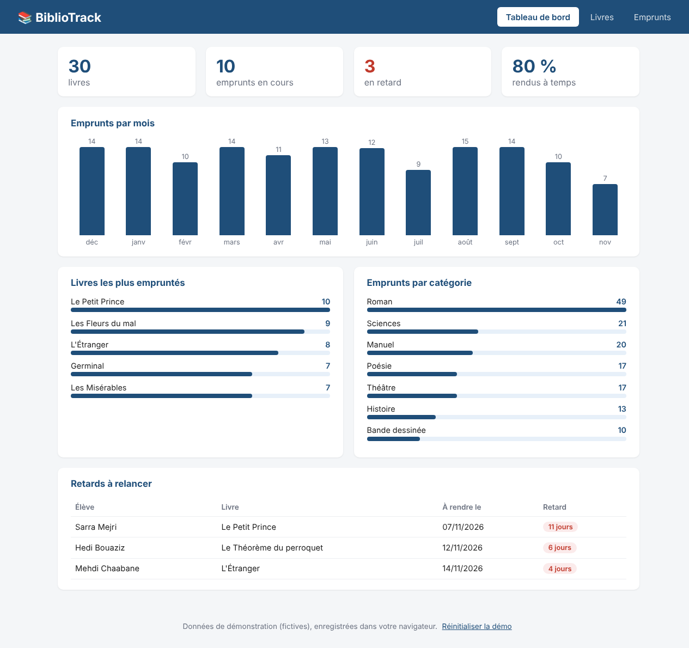

# 📚 BiblioTrack

Application web de gestion d'une bibliothèque scolaire : catalogue des livres, emprunts et retours, détection des retards et tableau de bord des statistiques.

**👉 Essayer l'application : https://jebriyasmin0-eng.github.io/bibliotrack/**



## Fonctionnalités

- **Tableau de bord** : chiffres clés, emprunts par mois, livres les plus empruntés, emprunts par catégorie, liste des retards à relancer.
- **Catalogue** : recherche par titre ou auteur, filtre par catégorie, disponibilité de chaque livre, ajout de livres.
- **Emprunts** : enregistrement d'un emprunt et d'un retour, avec vérification des règles :
  - un livre déjà emprunté ne peut pas être prêté ;
  - un élève peut avoir au maximum 3 livres ;
  - un élève qui a un livre en retard doit d'abord le rendre.
- Les données sont **enregistrées dans le navigateur** : elles restent quand on revient sur le site.

Les données de démonstration (livres, élèves, historique d'un an d'emprunts) sont fictives.

## Technologies

HTML, CSS et JavaScript, sans bibliothèque externe. Tests avec le module de test intégré à Node.js.

## Organisation du code

| Fichier | Rôle |
| --- | --- |
| `index.html` | structure de la page (3 onglets) |
| `css/style.css` | mise en forme, adaptée aux téléphones |
| `js/calculs.js` | règles de la bibliothèque : retards, vérifications, statistiques |
| `js/donnees.js` | données de démonstration |
| `js/stockage.js` | sauvegarde dans le navigateur (localStorage) |
| `js/app.js` | affichage et réactions aux clics |
| `tests/calculs.test.js` | tests des règles |

## Lancer le projet

Ouvrir `index.html` dans un navigateur, sans rien installer.

Pour lancer les tests (Node.js 18 ou plus) :

```bash
node --test
```
